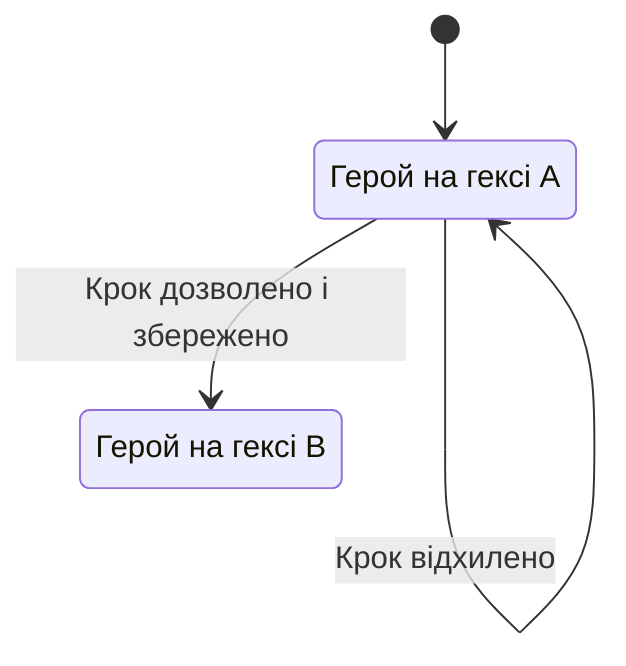
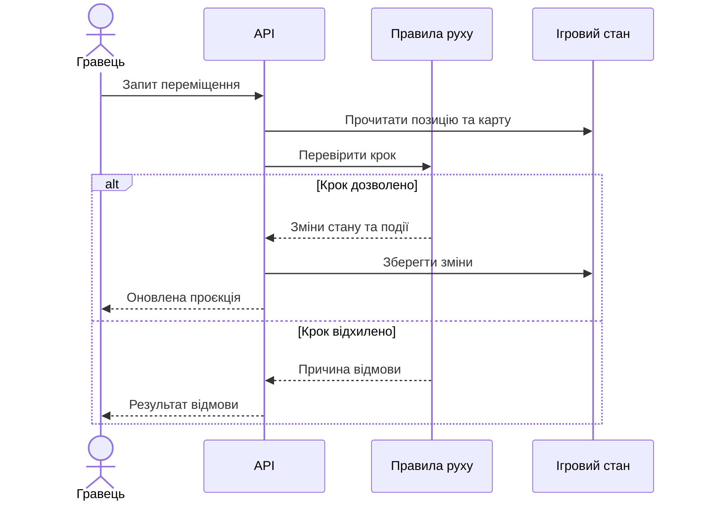

# Архітектурний аудит Hexoflat

Аудит запускається для конкретної механіки, сценарію, підсистеми або набору змін. Одиниця перевірки — сценарій із визначеним ігровим контрактом, початковим станом і результатом, який можна спостерігати. Почніть з одного базового сценарію й найризикованішої відмови. Додавайте решту перевірок за інваріантами обраного потоку. Шляхи до коду й конфігурації наведено від кореня Hexoflat.

## Цілі

- Зберігати ігрові інваріанти під час команд, відмов, повторів, перезавантаження і синхронізації. Приклади — один власник екземпляра предмета, коректний баланс Will, одна видача одноразової нагороди й узгоджений порядок ходу.
- Встановити власника кожного правила, стану і ресурсу. Простежити, хто може їх змінювати, хто читає результат і хто відповідає за час життя ефектів.
- Перевіряти розширюваність через реалістичну наступну зміну. Додати в уявний сценарій нову дію, карту, предмет чи правило й порахувати, де доведеться змінювати контракти, повторювати правила або підтримувати зайві переходи між шарами.
- Зберігати керовану поведінку під навантаженням, після збоїв та під час переходів між сценами. Вимірювати коректність відновлення, затримку дій, плавність рендера й життєвий цикл ресурсів.

ISO/IEC/IEEE 42010 задає спосіб описати архітектурні ракурси й питання зацікавлених сторін. ISO/IEC 25010 дає модель для вибору критеріїв якості. Сценарії QAW роблять ці критерії вимірюваними, а ATAM допомагає порівнювати компроміси, наприклад між швидкою реакцією інтерфейсу та складністю узгодження із сервером. [ISO/IEC/IEEE 42010](https://www.iso.org/standard/74393.html) · [ISO/IEC 25010](https://www.iso.org/standard/78176.html) · [SEI QAW](https://www.sei.cmu.edu/library/quality-attribute-workshops-qaws-third-edition/) · [SEI ATAM](https://www.sei.cmu.edu/library/architecture-tradeoff-analysis-method-collection/)

## Порядок аудиту

1. **Зафіксувати область і версію.** Записати сценарій, коміт або точний diff, правила гри та джерело очікувань. Звірити проєктні правила й актуальні рішення з виконуваним кодом. За паралельної розробки прив’язати докази до відтворюваного зрізу. Правила Hexoflat — `CLAUDE.md`
2. **Описати спостережуваний контракт.** Для кожного сценарію записати учасника, початковий стан, дію, умови, очікуваний результат і спосіб його виміряти. Вибрати базовий шлях і доречні поєднання порядку подій, ролей, збоїв, версій даних та навантаження.
3. **Простежити шлях виконання.** Знайти реальну точку входу, валідацію, правило, усіх авторів і читачів стану, збереження та видимий результат. Для серверної механіки простежити шлях від вводу через API й engine до транзакції, проєкції та UI. Для локальної взаємодії простежити composable, реактивність, власника сцени та PixiJS.
4. **Перевірити межі.** Зіставити залежності й час життя ресурсів із призначенням шарів. У Hexoflat engine володіє правилами, API виконує серверні команди та збереження, Vue і Pinia керують станом інтерфейсу та відображенням проєкцій, а PixiJS володіє ресурсами рендера. Для UI перевірити окремо локальний стан, спільний стан і кеш серверних проєкцій. Engine — `.claude/skills/hexoflat-engine/SKILL.md` · Стан у Vue — `.claude/skills/hexoflat-web-state/SKILL.md` · PixiJS у Hexoflat — `.claude/skills/hexoflat-render/SKILL.md`
5. **Зібрати докази.** Для межі залежностей показати активний імпорт або шлях викликів. Для правил запускати Vitest, для транзакцій і паралельних команд — інтеграцію з PostgreSQL, а для поведінки браузера — Playwright. Браузерні сценарії запускати через `sh scripts/pre-push-e2e.sh <spec>` з наявними Feature, Page і Component. Для тестів із каталогу `slow` додати `E2E_INCLUDE_SLOW=1`. Використовувати фікстури для початкового стану й контролю часу. Дію, яку аудит має довести, виконувати через штатну точку входу. Для продуктивності зафіксувати базовий профіль і погоджені метрики до порівняння. E2E у Hexoflat — `apps/playwright/README.md` · Скрипт локального E2E — `scripts/pre-push-e2e.sh`
6. **Спробувати спростувати гіпотезу.** Звірити назву тесту з фактичною дією та твердженнями. Перевірити результат у потрібний момент і після завершення асинхронної роботи. Простежити шлях реалізації реалістичної наступної зміни. Порівняти поточне рішення з найменшою зміною, що усуває першопричину, і з ширшим варіантом, якщо у нього є вимірювана перевага.
7. **Записати результат.** Зафіксувати контракт, очікуване й фактичне, код, спосіб відтворення, наслідок, доказ причини й критерій приймання рекомендації. Аудит завершено, коли для кожного погодженого сценарію є відтворюваний результат або конкретно описана прогалина в доказах.

## Інструкція для опису доменних моделей

Запускати цей крок разом із запитом на оцінку функціональності. Область береться з запиту, версія коду — з вказаного коміту або зафіксованого поточного зрізу.

> Оціни архітектуру переміщення героя. Перед висновками склади карту всіх доменних моделей, які цей потік читає, змінює, створює або видаляє. Опиши поля, зв’язки та джерела в коді. Побудуй схеми переходів стану й взаємодії об’єктів за цією інструкцією.

### Порядок пошуку моделей

1. Знайти фактичні точки входу та кінцеві результати погодженого сценарію. Простежити виконання вперед від вводу або команди до правила, запису, події, проєкції та рендера. Від кожної зміни стану пройти назад до даних, від яких залежить результат.
2. Переглянути обробники й усі досяжні гілки в межах сценарію, включно з відмовами, повтором, застарілою відповіддю, відновленням і подіями, які запускають інші зміни. Розв’язати реєстрації обробників, експорти, імпорти типів, `z.infer`, дискриміновані варіанти й моделі, сховані за адаптерами. Для навігації використовувати пошук посилань TypeScript і перевірку місць виконання. [TypeScript Compiler API](https://github.com/microsoft/TypeScript/wiki/Using-the-Compiler-API)
3. Завести запис для кожної задіяної моделі, включно з моделями, які потік лише читає. Для її представлень показати зв’язок між доменним станом, командою, подією, схемою збереження і клієнтською проєкцією, де ці представлення існують. Споживачі на кшталт PixiJS і транспортні адаптери доповнюють схему взаємодії.
4. Зіставити результат з усіма читаннями, записами, створеннями та видаленнями на знайдених шляхах. Для кожної моделі вказати, на який крок вона впливає. Прив’язати поля, зв’язки й переходи до версії та рядків коду. Для динамічного шляху, який лишився неясним, записати потрібну перевірку.

### Реєстр і форма для кожної моделі

| Модель             | Роль у сценарії                              | Дії над станом                         | Зв’язки та власник                                              | Посилання на код           |
| ------------------ | -------------------------------------------- | -------------------------------------- | --------------------------------------------------------------- | -------------------------- |
| Точна назва з коду | Правило або результат, який від неї залежить | Читання, зміна, створення чи видалення | Пов’язані моделі, ключ зв’язку, дозволена кількість екземплярів | Визначення й активний шлях |

Для кожної моделі додати окрему картку з її призначенням, ідентичністю, інваріантами, місцем збереження та поведінкою під час відновлення. Включити поля й варіанти, від яких залежить перевірюваний контракт. Для аудиту видимості, міграцій або сумісності схем описати весь контракт відповідної межі.

| Поле             | Тип і допустимі значення            | Обов’язковість і значення за замовчуванням | Хто читає і змінює                            | Збереження й видимість                             | Код                        |
| ---------------- | ----------------------------------- | ------------------------------------------ | --------------------------------------------- | -------------------------------------------------- | -------------------------- |
| Точний шлях поля | Тип, одиниця, зв’язок або обмеження | Умови наявності, `null`, старий формат     | Правило, команда, проєкція або інший споживач | Збережене, обчислюване чи тимчасове. Кому доступне | Схема й місце використання |

### Переходи та взаємодія

Для станів записати початкову умову, тригер, перевірки, змінені поля, події й кінцеву умову. Переходи відмови та повтору також відобразити, коли шлях їх обробляє. Для стану, який визначається кількома полями, показати відповідну умову з коду.

| Початковий стан           | Тригер                                | Умова               | Зміни і події                  | Кінцевий стан              | Код              |
| ------------------------- | ------------------------------------- | ------------------- | ------------------------------ | -------------------------- | ---------------- |
| Стан або умова над полями | Команда, подія, таймер чи відновлення | Дозвіл і передумови | Моделі, поля та побічні ефекти | Стан або результат відмови | Обробник і доказ |

Побудувати Mermaid `stateDiagram-v2` для моделей зі значущими переходами. Порядок читань, записів і повідомлень між моделями показати в `sequenceDiagram`. Додати межі транзакції, асинхронні відповіді, відмови та повтори, якщо вони змінюють висновок. Таблиця переходів зберігає деталі та посилання на код. [Mermaid State Diagrams](https://mermaid.js.org/syntax/stateDiagram.html) · [Mermaid Sequence Diagrams](https://mermaid.js.org/syntax/sequenceDiagram.html)

### Приклад для переміщення героя

На вході простежити, як запит визначає героя, карту й цільову клітинку. Від результату пройти до моделей, що визначають доступність переходу, витрати, позицію, стан карти, події та публічну проєкцію. Включити пов’язані механіки на кшталт туману війни, переходу між картами чи засідки, якщо їх запускають підтверджені шляхи в обраній області.

Умовний приклад позначень для результату одного кроку.

## Перевірки стійкості

### Гонки та порядок подій

Для асинхронної логіки керувати порядком завершення через відкладені проміси, тестовий годинник або планувальник fast-check. Прив’язувати перехід до конкретної події, наприклад до отримання нової проєкції чи демонтажу сцени. Приклад — клієнт починає завантаження карти A, переходить на B, а відповідь A приходить після готовності B. Перевірити активну карту, її ревізію, проєкцію і стан вводу після завершення обох запитів. Аналогічно перевірити watcher, що завершується після зміни сесії або виходу з компонента. [fast-check Race Conditions](https://fast-check.dev/docs/advanced/race-conditions/) · [Vue Watcher Cleanup](https://vuejs.org/guide/essentials/watchers.html#side-effect-cleanup) · [Playwright Clock](https://playwright.dev/docs/clock)

Для конфліктів збереження використовувати окремі з’єднання із реальною PostgreSQL та точки синхронізації на потрібних етапах. Фіксувати, що потрібний порядок справді відбувся. Перевірити відповіді обох команд, проміжні видимі ефекти та остаточний стан за незалежними очікуваннями з контракту або фікстури. Для спільного ресурсу звірити баланс, власника, ревізії відповідних агрегатів і журнал команд. Рівень ізоляції, блокування та повтори оцінювати на конкретному інваріанті. [PostgreSQL Transaction Isolation](https://www.postgresql.org/docs/16/transaction-iso.html)

### Видимість даних і права доступу

Для кожної ролі визначити дозволені об’єкти, поля та події. Перевіряти фактичні серіалізовані дані REST і WebSocket, включно з вкладеними полями, повідомленнями про помилки і відповіддю після повторного підключення. У підземеллі це може стосуватися чужого інвентарю, туману війни, нерозкритого луту й внутрішнього seed, якщо правила залишають їх прихованими. Для WebSocket перевірити аудиторію кожної події та актуальність дозволу після зміни членства. Явна проєкція визначає поля на виході. TypeScript-тип описує їх під час компіляції. [OWASP ASVS 5.0](https://asvs.owasp.org/) · [OWASP API3](https://api-security.owasp.org/editions/2023/en/0xa3-broken-object-property-level-authorization/) · [OWASP WebSocket Security](https://cheatsheetseries.owasp.org/cheatsheets/WebSocket_Security_Cheat_Sheet.html) · [TypeScript Erased Types](https://www.typescriptlang.org/docs/handbook/2/basic-types.html#erased-types)

Зіставити дві синтетичні фікстури, що мають однаковий видимий стан і різні приховані значення. Звірити форму кожної серіалізованої відповіді з переліком дозволених полів, потім порівняти значення, які за контрактом мають збігатися. Явно перелічити мінливі поля й дозволені похідні. Наприклад, публічний косметичний `worldSeed` має власний контракт у `packages/engine/src/world/client-projection.ts`. Після виходу й входу іншим тестовим акаунтом перевірити активний кеш і UI в момент надходження запізнілої відповіді та після завершення запитів. Для логів і телеметрії звірити поля з політикою журналювання, зокрема виключення токенів, секретів і приватних payload. [OWASP Logging](https://cheatsheetseries.owasp.org/cheatsheets/Logging_Cheat_Sheet)

### Створення та видалення об’єктів

Для вибраного типу об’єкта описати його ідентичність, джерело створення, власника, дозволені фази й кількість екземплярів. Простежити всі точки, які можуть його створити або відновити, зокрема команду, подію, спавнер, ініціалізацію сцени, завантаження сейву та reconnect. Описати, коли об’єкт має бути видалений, повернений у пул або збережений за правилами гри. Застосувати це до предметів, ворогів, підземель і сесій, а також до PixiJS applications, спрайтів, підписок і таймерів.

- **Дозвіл на створення.** Перевірити серверний результат для фікстур із різними ролями, власниками й фазами. Для сценарію, де контракт вимагає відмови, очікувати відмову й нуль нових екземплярів у стані, БД і проєкціях. Для дозволеного створення перевірити джерело, власника та встановлену правилами кількість. [OWASP ASVS](https://asvs.owasp.org/) · [OWASP API6 про обмеження доступу до бізнес-операцій](https://api-security.owasp.org/editions/2023/en/0xa6-unrestricted-access-to-sensitive-business-flows/)
- **Дублікати після повтору або гонки.** Окремо перевірити повтор тієї самої команди та дві різні команди для одного одноразового ігрового ефекту. Повторити завантаження, подію, приєднання до групи або ініціалізацію під час ще активної спроби. Звірити допустиму кількість створень і стабільні ідентифікатори, зокрема тимчасові дублікати, які можуть зникнути до фінального знімка. Для реляційних записів перевірити унікальність і зовнішні ключі, а для об’єктів усередині ігрового агрегату довести відповідні інваріанти агрегату. [Amazon Builders’ Library про ідемпотентність](https://aws.amazon.com/builders-library/making-retries-safe-with-idempotent-APIs/) · [PostgreSQL Constraints](https://www.postgresql.org/docs/16/ddl-constraints.html)
- **Зациклення створення.** Простежити, чи може створення спричинити повторний виклик того самого обробника через подію, watcher, підписку або retry. Подати тестову послідовність із повтором і циклічними залежностями там, де вони можливі. Довести, що обробка завершується або переходить у передбачений стан очікування, кількість створень відповідає обмеженню механіки, а черга стабілізується. Для генератора перевірити також випадок, коли вичерпалися придатні місця або кандидати. [CWE-835 про нескінченні цикли](https://cwe.mitre.org/data/definitions/835.html) · [CWE-770 про межі виділення ресурсів](https://cwe.mitre.org/data/definitions/770.html)
- **Очищення після кожного завершення.** Перевірити успіх, відмову, скасування, завершення асинхронної ініціалізації після виходу з екрана та повторний виклик очищення. Після завершення асинхронної роботи перевірити посилання, підписки, таймери й незавершену роботу за ідентичністю та власником. Для збережених об’єктів перевірити правила видалення залежних записів і повернення в проєкцію після reload. Для спільних ресурсів перевірити час життя згідно з контрактом їхнього власника. [CWE-404 про звільнення ресурсів](https://cwe.mitre.org/data/definitions/404.html) · Тести асинхронної ініціалізації дошки — `apps/web/src/render/use-observed-board-app.test.ts`

У доказі зафіксувати кількість створених, звільнених і живих екземплярів на кожному контрольному етапі. Наприклад, дошка починає ініціалізуватися, другий сигнал надходить до її завершення, сцена закривається, а початковий виклик повертає результат із запізненням. Перевірка має показати дотримання ліміту запусків, звільнення ресурсів закритої сцени й готовність наступної дошки до вводу.

### Нетипові дані та послідовності

- **Валідація формату.** Перевірити пропущені поля, `null`, граничні значення, порожні списки та старі версії команд або сейвів. Очікувану поведінку визначає контракт конкретної межі — відмова, міграція або обробка дозволеного старого формату.
- **Ігрові інваріанти.** Підготувати синтаксично правильні фікстури з некоректними зв’язками. Наприклад, той самий `instanceId` у двох комірках, Will понад місткість або проєкція для попередньої карти. Простежити реакцію читача чи команди й перевірити, що пошкодження локалізоване та відповідає контракту відновлення.
- **Спільні посилання на стан.** Якщо проєкція або снапшот обіцяє незалежність, змінити вкладене значення в об’єкті, який повернув сам перевірюваний код. Далі звірити авторитетний стан, попередню ревізію та проєкції інших клієнтів. Для спільної незмінної структури перевірити заявлений контракт незмінності.
- **Тести на основі властивостей і моделі.** Генерувати послідовності на кшталт «перемістити предмет → відхилити дію → зберегти → завантажити → повторити команду». Після кожного кроку перевіряти інваріанти через незалежні спостереження або малу модель. Для відтворення зберігати seed, шлях мінімізації, версію та найкоротшу послідовність, яка ламається. Для командної моделі fast-check також може знадобитися `replayPath`. [fast-check Model Based Testing](https://fast-check.dev/docs/advanced/model-based-testing/)

### Перевірки на стиках механік

| Перевірка                           | Що має довести сценарій                                                                                                                                                                                                                                                            |
| ----------------------------------- | ---------------------------------------------------------------------------------------------------------------------------------------------------------------------------------------------------------------------------------------------------------------------------------- |
| Збереження предметів між системами  | Простежити унікальний предмет від джерела через підбір до сумки, рук, сховища або продажу. На кожному переході звірити доменний ідентифікатор, дозволеного власника та відсутність дубліката. Для стеків звірити кількість у джерелі й отримувачі з урахуванням дозволених витрат. |
| Історичний сейв із продовженням гри | Завантажити фікстуру відомої попередньої версії, виконати штатну команду, зберегти й завантажити знову. Звірити змінений прогрес і збережені ідентифікатори та згенеровані характеристики. Зафіксувати версію фікстури й шлях міграції.                                            |
| Межі ігрового часу                  | Виконати дію перед дедлайном, точно на межі й після неї за керованим авторитетним годинником. Якщо є клієнтський таймер, затримати відповідь до його оновлення. Звірити прийняття команди, фазу і відображення після синхронізації.                                                |
| Підказка UI та рішення сервера      | Зіставити результат підказки й серверної команди за однакового стану. Потім змінити стан між підказкою та командою. Перевірити передбачений результат і відновлення актуальної ціни, позиції або інвентарю в UI.                                                                   |

### Збої на межах операції

Визначити нормальний стан, очікувану поведінку під час збою та критерій відновлення. У тестовому середовищі перевірити збій до commit, втрату підтвердження після commit, розрив під час отримання оновлень і перезапуск сервера, якщо сценарій передбачає відновлення. Для відмови транзакції звірити всі записи, що мали змінитися разом. Для серверного повтору зафіксувати область дії `commandId` і правила повтору, підтвердити фіксацію першої спроби, повторити її з тим самим ідентифікатором і перевірити один збережений ігровий ефект. Окремо перевірити штатне відновлення клієнта, актуальну проєкцію і повторні видимі ефекти. Виміряти час відновлення, якщо для нього задано бюджет. [AWS Well-Architected Resilience Testing](https://docs.aws.amazon.com/wellarchitected/latest/framework/rel12-bp04.html) · [Amazon Builders’ Library про ідемпотентність](https://aws.amazon.com/builders-library/making-retries-safe-with-idempotent-APIs/)

### Витоки ресурсів і стресове навантаження

Для Vue і PixiJS повторити цикл «увійти → почати анімацію або завантаження → вийти → повернутися». Після прогріву кешу порівняти стан спокою між циклами. Спостерігати за живими Pixi applications, підписками тикера, таймерами й об’єктами, утримуваними після демонтажу. Використати `liveApps`, `sharedTickerListeners` та `heroTokenSettled` для спостереження за переходом. Звірити звільнення ресурсів за власником або ідентифікатором і виконати дію на новій дошці. Для висновку про пам’ять додати профіль heap або телеметрію GPU. Врахувати життєвий цикл спільних текстур. Якщо сценарій вимагає відновлення WebGL, змоделювати втрату контексту й перевірити повторну готовність дошки. Поточні перевірки рендера — `docs/architecture/map-architecture-improvement-plan.md` · [PixiJS Garbage Collection](https://pixijs.com/8.x/guides/concepts/garbage-collection) · [Chrome DevTools Memory](https://developer.chrome.com/docs/devtools/memory-problems) · [Khronos WebGL Context Loss](https://wikis.khronos.org/webgl/HandlingContextLost)

Для серверних потоків задати звичайне навантаження, короткий сплеск і тривалий прогін. Для гри вимірювати час від команди до підтвердження, час відновлення, рівень помилок та розмір черг. Для браузера додати час кадру й вводу на цільовому пристрої. Визначати критерії проходження до запуску, наприклад бюджет p95 затримки й допустиму частку помилок. У тому ж сценарії перевіряти ігрові інваріанти, зокрема унікальність видачі та збіжність стану після піку. [Grafana k6 Performance Testing](https://grafana.com/docs/k6/latest/testing-guides/automated-performance-testing/) · [Grafana k6 Thresholds](https://grafana.com/docs/k6/latest/using-k6/thresholds/)

### Перевірка чутливості тестів

Мутаційне тестування тимчасово змінює код і перевіряє, чи тести помічають зміну. Для критичного правила провести успішний контрольний прогін, потім застосувати одну цільову мутацію в ізольованому зрізі. Наприклад, вимкнути перевірку актуальності відповіді й підтвердити, що падає конкретне твердження про активну карту. Помилку компіляції, збій підготовки або загальний таймаут записати як недійсний прогін. Якщо тест пройшов із мутацією, з’ясувати, чи вона змінює контракт і якої перевірки бракує. Для вибраних файлів можна використати StrykerJS з Vitest. [Stryker Mutation Testing](https://stryker-mutator.io/docs/) · [Stryker Vitest Runner](https://stryker-mutator.io/docs/stryker-js/vitest-runner/)

## Групове проходження підземелля після R2

Кооператив заплановано після R2 за `docs/release/FIRST-RELEASE-CHECKLIST.md`. До його появи у вибраному зрізі застосовувати сценарії ізоляції акаунтів, повторної сесії одного героя та відновлення його стану. Для групового сценарію звіряти спільний стан підземелля, персональний стан героя і проєкцію кожного учасника. Для одночасного керування кількома гравцями потрібна фікстура з окремим акаунтом, `BrowserContext` і явним контекстом учасника у Feature-шарі. Поточний `apps/playwright/src/framework/test-context.ts` зберігає один активний `Page`. Вимоги до кількості гравців, входу в активний бій і розподілу луту визначають межі перевірки. [Playwright Multiple Contexts](https://playwright.dev/docs/browser-contexts#multiple-contexts-in-a-single-test) · [Heroic Labs Authoritative Multiplayer](https://heroiclabs.com/docs/nakama/concepts/multiplayer/authoritative/)

| Сценарій                            | Що довести                                                                                                                                                                                                                                            |
| ----------------------------------- | ----------------------------------------------------------------------------------------------------------------------------------------------------------------------------------------------------------------------------------------------------- |
| Вхід групи та приєднання в процесі  | Кожен бачить дозволену проєкцію потрібного підземелля, фази, складу групи та ревізії. Одночасні запити на старт створюють передбачену кількість підземель. Повторне приєднання відновлює належного героя, якщо так визначає контракт.                 |
| Права на керування героєм           | Керування належить учаснику, якого визначають правила групи. Після виходу або передачі керування запізніла дія попередньої сесії обробляється за актуальним правом і фазою.                                                                           |
| Одночасні дії                       | Дві дії на одному гексі, з одним предметом або в одній фазі черги завершуються в дозволеному порядку. Витрати, власність і прогрес співпадають із серверним результатом.                                                                              |
| Затримка чи розрив під час ходу     | Серверний дедлайн і правила очікування визначають результат для всієї групи. Після повернення гравець отримує дозволену актуальну проєкцію. Відновлення охоплює пропущені події, повтори і перехід на повний snapshot, якщо його передбачає контракт. |
| Різна видимість                     | Кожен учасник отримує свої дозволені тайли, цілі, лут і стан героя. Одержувачі broadcast-подій відповідають актуальному складу групи та правилам видимості.                                                                                           |
| Завершення, нагорода і збереження   | Результат входить у прогрес належних учасників. Одноразові ефекти застосовуються один раз. Після повторного входу збережений результат і стан клієнтів узгоджуються з сервером.                                                                       |
| Різні версії та різний темп рендера | Клієнт зі старою схемою отримує передбачене контрактом оновлення або відмову. Повільний клієнт, фонова вкладка чи анімація зберігають узгодженість із серверною фазою та дедлайнами.                                                                  |

Профіль мережі задавати для кожного клієнта окремо. Перевіряти затримку, її коливання, розрив і масове повторне підключення за потреби. На рівні застосунку моделювати запізнілі відповіді від різних джерел та пропущені події між з’єднаннями. У Socket.IO порядок доставки повідомлень і відновлення пропущених подій мають різні гарантії. Для аудиту потрібно перевірити фактичний спосіб відновлення, який використовує потік Hexoflat. [Epic Games Network Emulation](https://dev.epicgames.com/documentation/unreal-engine/using-network-emulation-in-unreal-engine) · [Socket.IO Delivery Guarantees](https://socket.io/docs/v4/delivery-guarantees/)

### Приклад комбінованого сценарію

Група може отримати одну спільну нагороду, яку за правилами видають один раз. Гравці A і B надсилають дозволені команди в один період. Команда A фіксується в БД, її відповідь губиться, а B отримує передбачений результат для своєї команди. Після reconnect A надсилає ту саму команду з тим самим ідентифікатором.

Доказ проходження — одна видача в збереженому стані, один відповідний ігровий ефект та актуальна проєкція для кожного гравця після синхронізації. Перевірити також порядок, у якому першою фіксується дія B, й переконатися, що нагороду отримує учасник, якого визначає правило. Серверна перевірка доводить атомарність та ідемпотентність, а клієнтська показує, що обидва учасники бачать правильний фінал за своїми правилами видимості. [Amazon Builders’ Library про семантику повтору](https://aws.amazon.com/builders-library/making-retries-safe-with-idempotent-APIs/)

## Аудит залежностей

### Чинні залежності

CI Hexoflat перевіряє відомі вразливості production-залежностей через `pnpm run audit` з порогом `high`. Додатковий інформаційний прогін охоплює все дерево залежностей. Обидва виконуються після інсталяції. У звіті зафіксувати поріг, стан сканера, висновки та вплив на запуск E2E і публікацію окремо. Якщо питання стосується install-скриптів або походження пакета, перевірити lockfile і метадані до інсталяції. Огляд конкретного потоку починати з пакетів, які він використовує, та їхнього шляху до збірки або виконання. Скрипти workspace — `package.json` · CI Audit — `.github/workflows/ci.yml` · [OWASP SCVS](https://scvs.owasp.org/)

1. **Встановити склад і використання.** Зіставити маніфести та фактичні версії з `pnpm-lock.yaml`. Використати `pnpm why`, щоб знайти ланцюжок до workspace. Врахувати імпорти, конфігурацію Vite і ESLint, CLI, скрипти CI, динамічні завантаження, нативні або optional-пакети. Фіксувати, де пакет запускається — браузер, сервер, тести, CI або інсталяція. Для кандидатів на видалення можна використати Knip, після чого підтвердити використання за точками входу й прогоном перевірок. [pnpm why](https://pnpm.io/cli/why) · [Knip](https://knip.dev/explanations/how-knip-works)
2. **Перевірити відомі вразливості.** Звірити advisory, уражений діапазон, зафіксовану версію, середовище та шлях використання. Окремий аналіз lockfile через OSV-Scanner допомагає перевірити покриття сканування. Записати версії сканерів і дату звірки. Якщо уражена поведінка належить іншому режиму використання пакета, зафіксувати це з посиланням на конфігурацію чи код. [pnpm audit](https://pnpm.io/cli/audit) · [Формати OSV-Scanner](https://google.github.io/osv-scanner/supported-languages-and-lockfiles/)
3. **Перевірити застарівання й надлишок.** Читати deprecation конкретної версії, підтримувані гілки та рекомендації супровідників. Зіставити з вимогами Node, Vue, PixiJS і TypeScript. Для надлишку шукати підтверджено невикористані пакети, дублювання функцій і кілька версій у критичному bundle. Звірити причини кожної версії, включно з peer-вимогами та окремими потребами workspace. [npm Package Deprecation](https://docs.npmjs.com/deprecating-and-undeprecating-packages-or-package-versions/)
4. **Перевірити походження та шкідливі пакети.** Звірити точну назву, реєстр, source commit або наявну provenance, integrity у lockfile та install/build-скрипти. Розібрати незвичну зміну джерела чи власника пакета і перевірити налаштування `allowBuilds` та винятки `minimumReleaseAge` у workspace. Підозрілу версію перевіряти за метаданими, опублікованими сповіщеннями та вмістом артефакту в ізольованому середовищі. Походження пов’язує артефакт зі збіркою. Оцінка безпеки включає поведінку, склад і доступи цього артефакту. Налаштування pnpm — `pnpm-workspace.yaml` · [pnpm Supply Chain Security](https://pnpm.io/supply-chain-security) · [npm Provenance](https://docs.npmjs.com/viewing-package-provenance/) · [NIST SSDF](https://csrc.nist.gov/projects/ssdf)
5. **Порівняти варіанти.** Для кожної потрібної зміни оцінити підтримуване оновлення, видалення, можливість використати наявний API або заміну. Перевірити сумісність, ліцензію за правилами проєкту, розмір дерева залежностей, інсталяційні скрипти та вартість міграції. Прогнати регресійні перевірки потоку, збірки й тестової інфраструктури.

### Кандидати для вимірюваного покращення

- **Графіка й ресурси.** На одній завантаженій сцені порівняти поточні спрайти, атласи та формати на кшталт KTX2 з підтримкою PixiJS. Заміряти обсяг у байтах під час завантаження, кількість draw calls, час першого кадру, GPU-пам’ять та якість на цільових пристроях. У ціні зміни врахувати конвертацію, декодери й fallback. [PixiJS Assets](https://pixijs.com/8.x/guides/components/assets) · [PixiJS Compressed Textures](https://pixijs.com/8.x/guides/components/assets/compressed-textures)
- **Клієнтська продуктивність.** Взяти профіль DevTools і production-чанки як базу. За потреби додати аналізатор bundle, наприклад `rollup-plugin-visualizer` у пробній збірці. Кандидат на заміну має показати покращення цільової метрики — передавання, парсингу, запуску або реакції на ввід. [Chrome Performance](https://developer.chrome.com/docs/devtools/performance/reference) · [Bundle Visualizer](https://github.com/btd/rollup-plugin-visualizer)
- **Лінтери й межі модулів.** Перевірити, що поточні ESLint-правила охоплюють Vue template, TypeScript, цикли та обмеження E2E. Для графа залежностей оцінити повторне використання `dependency-cruiser`, який уже є в Playwright workspace. Для швидкості можна порівняти Oxlint на підтримуваних правилах. Заміну оцінити за часом і фактичним спрацюванням обов’язкових правил на одних і тих самих фікстурах. ESLint у Hexoflat — `eslint.config.js` · [dependency-cruiser Rules](https://github.com/sverweij/dependency-cruiser/blob/main/doc/rules-reference.md) · [Oxlint Migration](https://oxc.rs/docs/guide/usage/linter/migrate-from-eslint.html)
- **Збірка і CI.** Якщо вимірювання виявить вузьке місце в наявному Vite 7, порівняти Vite 8 з Rolldown на холодній і кешованій збірках. Перевірити Vue-плагін, CSS і чанки, base URL для Pages, завантаження ресурсів, мапи коду й E2E режим. Записати час збірки, розмір артефакту та кількість змін конфігурації. Поточний web workspace — `apps/web/package.json` · [Vite Migration from v7](https://vite.dev/guide/migration)

Для кожного кандидата визначити проблему й метрику до пробного запуску. Порівняти однакові версії контенту, фікстуру та цільове середовище. У результаті вказати виміряний ефект, ціну залежності та зміни в контрактах.

## Бюджети обсягу даних

Для кожної ділянки фіксувати обсяг у тому вигляді, у якому він має операційний ефект — файл у збірці, байти під час передавання, декодована текстура в пам’яті, об’єкт у БД або артефакт для деплою. Оцінювати типовий сценарій і великий сценарій, підтримуваний правилами гри. [Performance Budgets 101](https://web.dev/articles/performance-budgets-101) · [Chrome Network Reference](https://developer.chrome.com/docs/devtools/network/reference)

| Ділянка                          | Що виміряти                                                                                                                               | Що перевірити за зростання                                                                                                                                                           |
| -------------------------------- | ----------------------------------------------------------------------------------------------------------------------------------------- | ------------------------------------------------------------------------------------------------------------------------------------------------------------------------------------ |
| Перший запуск і перше підземелля | Початкові JS, CSS і ресурси під час холодного та кешованого завантаження. Розмір найбільших чанків і час готовності дошки.                | Великі імпорти контенту, дублікати залежностей, eager-завантаження сцен і локалей, надмірні preload. Порівняти розбивку чанків і завантаження ресурсів за сценою.                    |
| Графічні дані                    | Переданий обсяг у байтах, роздільність, час декодування та використання пам’яті текстурами на цільовій сцені.                             | Дублікати спрайтів, атласи, роздільність за DPR і формати з fallback. Заміряти виграш разом із вартістю декодера та якістю зображення.                                               |
| API та WebSocket                 | Розмір початкового snapshot і типових дельт для потрібної ролі, час серіалізації, обсяг надсилання всій групі та обсяг під час reconnect. | Повторення великих полів, частоту оновлень і ціни повної пересинхронізації. Порівняти компактні проєкції та дельти з перевіркою пропусків і відновлення.                             |
| Збереження та БД                 | Типові й великі JSON-документи, зростання журналу, таблиць та індексів, час backup і restore, якщо вони в області аудиту.                 | Повторюваний контент у сейвах, зайві снапшоти, правила архівації. Перевірити, що менший формат підтримує попередні сейви, replay та ідентичність і походження екземплярів предметів. |
| Збірка та деплой                 | Вміст і розмір `dist`, артефакту Pages, звітів CI і часу завантаження. Для контейнерних потоків виміряти build context і фінальний образ. | Великі файли в `public`, вихідні мапи, тестові фікстури, звіти та активи, що дублюються. Для контейнера перевірити `.dockerignore` і склад фінального шару.                          |

Для вебзбірки починати з `pnpm run size-limit` на свіжому `dist`. У `apps/web/package.json` задані бюджети для основного чанка, карти й входу. Окремо виміряти фактичне передавання й час готовності дошки. Для Pages звірити префікс `/hexoflat/` у згенерованих URL і врахування `GITHUB_PAGES` у ключі кешу вебзбірки. CI публікує весь `dist` і додає звіт Allure в `e2e-report`, якщо отримав артефакт звіту. Виміряти гру, звіт і повний артефакт. GitHub документує межу 1 GB для опублікованого сайту і 10 хвилин на деплой. Публікація Pages у CI — `.github/workflows/ci.yml` · [GitHub Pages Limits](https://docs.github.com/en/pages/getting-started-with-github-pages/github-pages-limits)

Для Vite звірити розмір файлів, звіт про стиснення і те, що браузер реально отримує. Попередження `build.chunkSizeWarningLimit` стосується нестисненого чанка. Каталог `public` за типової конфігурації копіюється до збірки. Для PostgreSQL розмір значення і сумарний розмір таблиці з індексами можна виміряти через `pg_column_size` і `pg_total_relation_size`. [Vite 7 Build Options](https://v7.vite.dev/config/build-options) · [Vite 7 Public Directory](https://v7.vite.dev/config/shared-options#publicdir) · [PostgreSQL Size Functions](https://www.postgresql.org/docs/16/functions-admin.html#FUNCTIONS-ADMIN-DBSIZE) · [Docker Build Context](https://docs.docker.com/build/concepts/context/)

Зберігати базовий вимір з комітом, варіантом збірки, сценою або фікстурою, метрикою, одиницею та погодженим бюджетом. Для нового релізу порівняти абсолютний розмір і приріст із базою. Після оптимізації повторити перевірки першого завантаження, відтворення сейвів, групової синхронізації або деплою відповідно до того, що змінилося.

## Вибір сценаріїв і запис доказів

Брати виміри, які взаємодіють у конкретному потоці, наприклад фазу гри, роль учасника, порядок завершення, стан мережі, версію даних і навантаження. Для широкого набору використовувати попарну комбінаторику як спосіб скоротити прогін. Для критичних ефектів явно включати потрібні комбінації трьох і більше умов, наприклад конфлікт двох команд, втрату підтвердження та повтор. [NIST SP 800-142 Practical Combinatorial Testing](https://csrc.nist.gov/pubs/sp/800/142/final)

### Картка сценарію

| Поле                     | Що записати                                                                                                                                                                   |
| ------------------------ | ----------------------------------------------------------------------------------------------------------------------------------------------------------------------------- |
| ID та статус             | Стабільний ID і статус для кожного спостереження.                                                                                                                             |
| Контракт та інваріант    | Джерело правила, очікуваний стан, запис або повідомлення.                                                                                                                     |
| Версія та середовище     | Коміт або збережений diff, версія формату чи контенту, конфігурація тесту, БД, браузер і прапорці, де вони важливі.                                                           |
| Фікстура та дія          | Ролі, початковий стан, джерело тестових очікувань, seed, годинник, керований порядок подій або точка збою.                                                                    |
| Очікуване і спостережене | Проміжний і фінальний результати. Ревізії порівнювати в межах відповідного агрегату, наприклад за `heroId` і видом агрегату. Для стану карти вказати `mapId` і належну сесію. |
| Доказ                    | Тип доказу, шлях або команда відтворення, артефакт, кількість виконаних, пропущених і повторених тестів.                                                                      |
| Висновок і приймання     | Для знахідки вказати вплив, пріоритет і впевненість у причині. Для рекомендації записати вимірюваний критерій приймання.                                                      |

Статуси сценарію — **заплановано**, **пройдено**, **дефект підтверджено**, **заблоковано**, **не застосовується**, **контракт не визначено**. Статус **пройдено** поширюється на твердження, які виконаний сценарій спостерігав на заявленому рівні. Локальний прогін API може пропустити PostgreSQL-тести, якщо БД недоступна. Перевірити підсумок виконання й зафіксувати причину пропуску. Налаштування — `apps/api/src/test-support/global-setup.ts`.

У журналах і трасах для діагностики достатньо корелювати тестовий ідентифікатор команди, серверну ревізію, фазу, результат і час. Прив’язка цих полів до фікстури дає змогу відрізнити затриману відповідь, повтор обробки та відмову без запису приватного ігрового стану. [OWASP Logging](https://cheatsheetseries.owasp.org/cheatsheets/Logging_Cheat_Sheet)

### Пілот зі скринею

**ID `LOOT-PILOT-01` · статус «заплановано».** Один герой стоїть поряд із закритою скринею, має достатньо Will і вільне місце в сумці. Фікстура задає відомий набір луту й доступні місця для нього. Очікуваний лут і вартість взяти з контракту та фікстури. Джерела для звірки — сценарії `REQ-LOOT-048`, `049`, `066`, `067` і `069` у `apps/api/src/world/world.integration.spec.ts`.

| Крок                                                | Критерій приймання                                                                                                                                                                    | Наявна точка входу для тесту                                                                                      |
| --------------------------------------------------- | ------------------------------------------------------------------------------------------------------------------------------------------------------------------------------------- | ----------------------------------------------------------------------------------------------------------------- |
| Відкрити скриню штатною командою                    | Скриня відкрита, Will витрачено один раз, зафіксовано один перехід відкриття й очікуваний лут на землі.                                                                               | `apps/api/src/world/world.integration.spec.ts`, `REQ-LOOT-048`.                                                   |
| Підібрати один предмет                              | Предмет зникає із землі й один раз з’являється в інвентарі. Звірити доменну ідентичність або кількість, а в інтеграції звірити відповідний запис ledger.                              | `packages/engine/src/chests/chest-loot.test.ts`, `REQ-LOOT-059`, і `apps/playwright/e2e/hero/loot-chest.spec.ts`. |
| Повторити команду відкриття з тим самим `commandId` | Сервер позначає результат як повтор. Will, лут на землі та інвентар зберігають стан після підбору. За журналом звірити один запис для цього `commandId`.                              | `apps/api/src/world/world.integration.spec.ts`, `REQ-LOOT-066`.                                                   |
| Перезавантажити сторінку                            | Проєкція показує відкриту скриню, коректну позицію героя, предмет у сумці та решту луту на землі. Для перевірки відновлення зіставити ці дані з повторно прочитаним серверним станом. | `sh scripts/pre-push-e2e.sh e2e/hero/loot-chest.spec.ts`.                                                         |

Для конфлікту підготувати дві окремі команди відкриття однієї скрині й керовано відтворити обидва порядки фіксації. У варіанті з втратою підтвердження затримати або відкинути відповідь команди, що змінила стан, після підтвердженого commit. Повтор із тим самим ID виконати на рівні серверного тесту. Для браузера пройти його штатний шлях відновлення та перевірити актуальну карту, відсутність повторної анімації для поточної події `CONTAINER_OPENED` і можливість виконати наступну дію. Перед прогоном заповнити версію, середовище й фікстуру. Після прогону записати результат кожного кроку та окремо статус комбінованого сценарію.

## Історія доповнень

- 2026-11-24 — Зведено базовий порядок аудиту, перевірки гонок, видимості даних, нетипових станів, збоїв, мутаційного тестування та навантаження. Додано сценарії групового підземелля, мережевого відновлення і спільних нагород.
- 2026-11-24 — Додано перевірки права створення, дублікатів, зациклення генерації та очищення об’єктів. Розширено груповий сценарій перевірками одночасного старту й повторного приєднання.
- 2026-11-24 — Додано аудит складу, безпеки та підтримки залежностей, критерії оцінювання нових пакетів і бюджети обсягу для гри, БД, збірки та деплою.
- 2026-11-24 — Додано інструкцію для побудови реєстру всіх задіяних доменних моделей, карток полів і схем станів та взаємодії.
- 2026-11-24 — Додано перевірки на стиках механік, картку результату, правила перевірки доказів і запланований пілот зі скринею. Уточнено межі кооперативу, використання чинних бюджетів та перевірку артефакту Pages.
