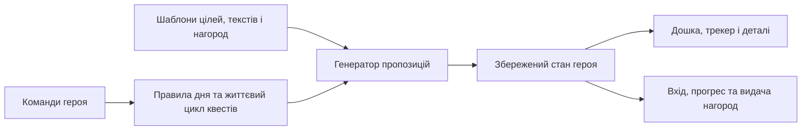

# Генератор квестів на ігровий день

Статус — план реалізації за результатами аналізу від 22.11.2026.

## 1. Цілі та погоджені правила

Герой отримує на дошці випадково згенеровані завдання з конкретною ціллю, короткою назвою й нагородою. Завершений квест зникає зі списку, а генератор заповнює звільнене місце за наявності підхожого варіанта. Сервер зберігає видані умови та прогрес героя.

| Рішення          | Правило для першого випуску                                                                                                                                                                                                 |
| ---------------- | --------------------------------------------------------------------------------------------------------------------------------------------------------------------------------------------------------------------------- |
| Пул              | Сім чинних шаблонів в одному пулі. Bone Hunter одноразовий. Treasure Seeker II та III входять до пулу доступних кандидатів після успіху на попередньому рівні.                                                              |
| Місткість        | До семи видимих карток разом у «Моїх квестах» і «На дошці». До трьох одночасно прийнятих квестів зі штатними доплатами 0 / 5 / 10 Волі.                                                                                     |
| Денна квота      | Передбачити параметр для максимальної кількості нових пропозицій на героя за день. У стартовій конфігурації числове обмеження вимкнене. Коли квоту задано, будь-яка нова видача витрачає її, включно з платним оновленням.  |
| Платне оновлення | Рандомізує список доступних карток. Ціна починається з 50 Волі та зростає на 25 після кожного успішного платного оновлення. Новий ігровий день повертає ціну до 50. Одна дія в наявному заголовку дошки.                    |
| Ігровий день     | Зміна дати UTC або досягнення одного з погоджених порогів за діями героя. Значення з попереднього плану — 150 витраченої Волі поза боєм, 5 завершень квестів, 3 походи в печеру. [Концепція дня](../shop/SHOP-PLAN.md#L574) |
| Розширення       | Шаблон на чинній механіці додається через контент і локалізацію. Для нового виду цілі додається обробник з його схемою та описом цілі. Денний облік і алгоритм дошки спільні.                                               |

Дошка використовує чинне компонування, стилі й взаємодії. Згенеровані назви, цілі та нагороди заповнюють наявні поля карток і поповера. Веб під’єднує ці поля до серверної проєкції. Єдине погоджене доповнення інтерфейсу — дія «Оновити» в наявному заголовку, оформлена в стилі дошки.

## 2. Чинні квести

| Шаблон                             | Ціль і локація                                                                                                               | Чинні ціна, завершення та нагорода                                                                                              |
| ---------------------------------- | ---------------------------------------------------------------------------------------------------------------------------- | ------------------------------------------------------------------------------------------------------------------------------- |
| `woodcutter`                       | 10 завершених дій CUT через `RESOURCE_GATHERED`. EARTH, `silesia` або `silesia-north`.                                       | Повторюваний, базова ціна 0, здача на дошці, 5 сокир.                                                                           |
| `stonebreaker`                     | 8 завершених дій MINE через `RESOURCE_GATHERED`. EARTH, ті самі сектори.                                                     | Повторюваний, базова ціна 0, здача на дошці, 30 монет.                                                                          |
| `scholar`                          | 15 правильних відповідей через `HALL_ANSWERED`. EARTH, Книга Волі в `camping`.                                               | Повторюваний, базова ціна 0, здача на дошці, 20 монет.                                                                          |
| `bone-hunter`                      | 3 вбитих вороги через `BATTLE_CLOSED.kills` після перемоги. UNDERWORLD, `cave`.                                              | Одноразовий, 5 Волі, здача в кемпі, щит із джерела UNDERWORLD.                                                                  |
| `seeker-1`, `seeker-2`, `seeker-3` | Рівні однієї експедиційної механіки Treasure Seeker. EARTH, вхід у `silesia`. Кожен рівень має свої параметри послідовності. | Повторювані, по 20 Волі за прийняття. Прийняття створює вхід. Результат визначається на маршруті, здобич забирається зі скрині. |

Джерела — [чотири лічильникові шаблони](../../packages/engine/src/quests/quests.content.ts#L14), [адаптер експедицій](../../packages/engine/src/quests/seeker-quests.ts#L6), [рівні Seeker](../../packages/engine/src/quests/seeker-content.ts#L59) і [таблиці їхніх скринь](../../packages/engine/src/content/loot-tables.content.ts#L38).

Для `count` подія `QUEST_READY` означає готовність до здачі. `QUEST_CLAIMED` надходить після успішної видачі нагороди, тоді запис зникає й оновлюється `done`. Повна сумка залишає квест готовим. Для Seeker `QUEST_RESOLVED` надходить на фінальному кроці або коли хибна стежка впирається в глухий кут. Успіх зараховується в `done`, а поле продовжує існувати для скрині, здобичі та виходу. `QUEST_COMPLETED` або `QUEST_FAILED` під час закриття поля можуть описувати той самий результат. [Claim](../../packages/engine/src/quests/quest-log.ts#L166) · [Розв’язання маршруту](../../packages/engine/src/quests/resolve-seeker-path.ts#L5) · [Закриття поля](../../packages/engine/src/quests/seeker-actions.ts#L147)

## 3. Карта залежностей

| Ділянка                    | Що працює зараз і де підключати генератор                                                                                                                                                                                                                                                                                                                                                                                                                                                                                                                                                                                                                                                                                                                                                                                                                                                                     |
| -------------------------- | ------------------------------------------------------------------------------------------------------------------------------------------------------------------------------------------------------------------------------------------------------------------------------------------------------------------------------------------------------------------------------------------------------------------------------------------------------------------------------------------------------------------------------------------------------------------------------------------------------------------------------------------------------------------------------------------------------------------------------------------------------------------------------------------------------------------------------------------------------------------------------------------------------------- |
| Схема та каталог           | `QuestDefinitionSchema` задає вимір, локації, умови `questDone`, ціль, ціну, нагороду, спосіб здачі й можливий об’єкт входу. `ALL_QUESTS` індексує `BOARD_QUESTS` і `SEEKER_QUESTS`. `validateContent` перевіряє контент, бюджет повторюваних нагород і параметри Seeker. Унікальність шаблонів слід перевіряти перед індексацією, бо перетворення масиву на об’єкт перезаписує повторний ID. [Каталог](../../packages/engine/src/quests/all-quests.ts) · [Схема](../../packages/engine/src/quests/quest-definition.ts) · [Валідатор](../../packages/engine/src/content/validate-content.ts#L16)                                                                                                                                                                                                                                                                                                              |
| Цілі та події              | `OBJECTIVES` рахує `count` і описує `expedition`. Zod-об’єднання наразі має два види, експедиція має лише `treasureSeeker`. `foldQuestEvents` бере визначення зі статичного каталогу. Джерела подій — завершувачі CUT/MINE, Книга Волі і закриття бою загонів. [Реєстр цілей](../../packages/engine/src/quests/objectives.ts) · [Обробка подій](../../packages/engine/src/quests/quest-hook.ts) · [Збір](../../packages/engine/src/registry/action-finishers-registry.ts#L75) · [Знання](../../packages/engine/src/knowledge/reducer.ts#L42) · [Бій](../../packages/engine/src/squads/squad-battle.ts#L198)                                                                                                                                                                                                                                                                                                   |
| Виконуваність              | Лічильниковий квест зараз перевіряє вимір події. Для точної цілі за локацією потрібен довірений `locationKey` місця дії. `BATTLE_CLOSED.kills` має загальну кількість убитих ворогів. Для майбутніх цілей на конкретний вид потрібна деталізація бойової події. Дерева Сілезії мають відростання 25 с. CUT вимагає сокиру, MINE — кирку. Книга Волі відкривається, коли поточна Воля нижча за місткість. [Лічильник](../../packages/engine/src/quests/quest-log.ts#L219) · [Локації](../../packages/engine/src/registry/location-key.ts) · [Терен Сілезії](../../packages/engine/src/content/boards/static/silesia.ts#L8) · [Дії з ресурсами](../../packages/engine/src/content/resources.content.ts) · [Книга Волі](../../packages/engine/src/knowledge/reducer.ts#L13)                                                                                                                                      |
| Дошка, оплата, здача       | USE/Read рукою відкриває панель. `QUEST_ACCEPT`, `QUEST_ABANDON` і `QUEST_CLAIM` ідуть через `hero:command` та `PlayerCommandService`. Сервер виводить сусідство з дошкою з позиції героя. `planClaim` використовує `grantToDraft`, Token Factory і `grantWill`. API фіксує зміну інвентарю в журналі предметів. [Контекст дошки](../../packages/engine/src/aggregates/server-quest-context.ts) · [Команди](../../packages/engine/src/aggregates/apply-quest-command.ts) · [Запис результату](../../apps/api/src/player/player-command.service.ts#L435)                                                                                                                                                                                                                                                                                                                                                       |
| Світ та вхід до експедиції | `reconcileQuestWorld` і світові переходи встановлюють маркер на досяжному вільному гексі. `ServerWorld.questEntrances` зв’язує ID квесту з об’єктом мапи. OPEN біля маркера запускає або відновлює run на копії терену. Точки інтеграції — визначення прийнятого екземпляра та його ID у прив’язках, світових проєкціях і командах входу. [Об’єкт карти](../../packages/engine/src/content/constructions.content.ts#L13) · [Розміщення](../../packages/engine/src/quests/world-entrances.ts) · [Узгодження світу](../../apps/api/src/quests/reconcile-quest-world.ts)                                                                                                                                                                                                                                                                                                                                         |
| Run, скриня та джерело     | `quest:command` → `QuestRunService` → `executeQuestRunCommand`. `srv-quest` містить приватний run, `GET /player/quest` повертає проєкцію. Поле run `offerId` зараз містить статичний ID. Вхід і пошук таблиці скрині читають `ALL_QUESTS`. Потрібно живити їх збереженими параметрами екземпляра. Для нагород перевикористати `TokenOrigin`, обмеження вимірів та фабрику предметів. [Команди run](../../packages/engine/src/quests/seeker-commands.ts#L130) · [Сервіс run](../../apps/api/src/quests/quest-run.service.ts#L107) · [Скриня](../../packages/engine/src/quests/seeker-chest.ts#L52) · [Контракт вимірів D4](../DIMENSIONS-PLAN.md#L98)                                                                                                                                                                                                                                                          |
| Стан героя і час           | `progress` v11 зберігає `active`, `done`, необов’язкові `placementActivations` та загальний `trips`. Ігрового дня й виданих пропозицій у коді поки немає. Player, World і QuestRun мають окремі командні шляхи зі спільним `commandId`. Світова подорож і квестові витрати потребують підключення до одного правила дня. Крамниця наразі визначає ціну оновлення за `trips`. [Стан](../../packages/engine/src/aggregates/progress-state.ts#L33) · [Апкастери](../../packages/engine/src/aggregates/registry.ts#L45) · [Час світу](../../apps/api/src/world/world.service.ts#L276) · [Походи](../../packages/engine/src/world/travel.ts#L158) · [Ціна крамниці](../../packages/engine/src/trade/plan-refresh.ts#L19)                                                                                                                                                                                           |
| Web і локалізація          | `applyProgress` гідратує журнал, а `useQuestView` складає список зі статичного каталогу. `capQuests` лишає сім карток з пріоритетом прийнятих. Локальний `VITE_SEEKER_QUESTS` за замовчуванням приховує картки в production. Від ID шаблону залежать іконки, поповер, рядки цілі, трекер, run і підсумок. `table` та `how` містять фіксовані числа. Перенести видимість типів до серверного пулу, а тексти цілі та нагороди формувати з фактичних параметрів. [Гідратація](../../apps/web/src/services/inventory/inventory-sync.ts#L106) · [Модель списку](../../apps/web/src/composables/use-quest-view.ts#L44) · [Ліміт та іконки](../../apps/web/src/services/quests/quest-board-model.ts) · [Прапорець](../../apps/web/src/composables/seeker-flag.ts) · [Панель](../../apps/web/src/a-game-scenes/map-scene/components/quests/quest-board.vue#L8) · [Тексти](../../apps/web/src/locales/uk/ui.json#L911) |
| Тестові точки входу        | Регресії engine, інтеграційні тести PostgreSQL, fake player server для web, компонентні тести дошки та Playwright для квестів, входу, паузи і здобичі. Сценарії негайного повторного прийняття тієї самої статичної картки слід оновити під ротацію пропозицій. [Engine](../../packages/engine/src/quests/quest-log.test.ts#L237) · [API дошки](../../apps/api/src/player/quest.integration.spec.ts) · [API run](../../apps/api/src/quests/quest-run.integration.spec.ts) · [Playwright дошки](../../apps/playwright/e2e/hero/quests.spec.ts) · [Playwright входу](../../apps/playwright/e2e/slow/hero/quest-world-entry.spec.ts)                                                                                                                                                                                                                                                                             |

## 4. Архітектура генератора

### Шаблон, пропозиція й активний квест

- `templateId` відповідає за передумови, одноразовість, підрахунок `done` та сталі метадані. `offerId` ідентифікує видані умови, які сервер приймає в командах і прив’язує до маркера. Для старих сейвів наявний `questId` читається як статичний шаблон і зберігає зв’язок зі старим run.
- В екземплярі зафіксовані день і порядковий номер видачі, ціль, вимір та локації, базова ціна прийняття, нагорода, ключі текстів і потрібні параметри експедиції. Доплата за активний слот розраховується на етапі прийняття за чинним правилом. Після фіналу Seeker потрібні параметри та версія профілю скрині лишаються в документі run до закриття поля. Історія завершень накопичується за шаблоном, а збережений список екземплярів обмежений картками дошки й чинним run.
- Чистий модуль генератора в engine приймає валідовані профілі, контекст героя, стан дня й RNG. Повертає заплановані пропозиції. `OBJECTIVES` і наявні обробники run далі відповідають за виконання. Один спільний пошук визначення екземпляра використовується у прогресі, Claim, прив’язках входу, run і проєкціях.
- Окремі потоки `deriveStream` для вибору шаблону, цілі, тексту й нагороди відтворюються із серверного секрету героя, ID дня, номера видачі та версії алгоритму. Стабільний порядок кандидатів робить результат відтворюваним. Повтор відображення або клієнтська мова впливають лише на представлення. [Seeded RNG](../../packages/engine/src/utils/random-seeded.ts#L27)

### Генерація цілей, назв і нагород

1. **Зібрати кандидатів.** Перевірити передумови, одноразовість, доступність механіки, валідні цільові локації та джерело нагороди. У правилах цілі враховувати потрібні інструменти, доступність ресурсу або бою й досяжний бюджет Волі. Тимчасовий баланс Волі перевіряти під час прийняття. Вимір дошки визначає місце прийняття, а вимір квесту — належний контекст виконання й здобичі.
2. **Вибрати зміст.** Для count запропонувати редакторські дискретні цілі або обмежені діапазони. Наприклад, `woodcutter` може одержати 7, 12 або 15 дерев. Для Stonebreaker вказувати кількість завершених добувань, для Scholar — правильні відповіді. Для Bone Hunter дозволяти лише цілі, підтверджені складом печери. Для Seeker рівень визначає дозволені правила, довжину сліду, підказки та профіль скрині. Кожна варіація проходить обмеження підказки, вартості Волі та прохідності. [Перевірки Seeker](../../packages/engine/src/quests/seeker-content.ts#L158)
3. **Дати короткі тексти з контенту.** Наприклад, «Хмиз до вечора» / «Зрубайте 7 дерев у Сілезії», «Дрова для табору» / «Зрубайте 12 дерев у Сілезії», «Зимовий запас» / «Зрубайте 15 дерев у Сілезії». Назви й описи мають ключі `uk/en`. Кількість, форма одиниці та дозволена локація підставляються в назву/опис, якщо їх там передбачає шаблон, а також у ціль і кроки в поповері. Приклади назви й цілі є матеріалом для пілоту.
4. **Зібрати нагороду.** Дати профілю цілі діапазон монет, ваги дозволених зіль і шанс на базове спорядження з відповідного виміру й рівня джерела. Складніша ціль може мати вищий бюджет нагороди. Базу й кількість зафіксувати під час видачі, а при Claim використати Token Factory та стабільне джерело від героя й `offerId`. Для точної публічної обіцянки предмета зберігати сам результат фабрики. Запропонований пілот зберігає щит як основну нагороду одноразового Bone Hunter. Для Seeker добирати дозволений профіль скрині й повторно використовувати чинний шлях здобичі. [Schema нагород](../../packages/engine/src/quests/quest-definition.ts#L26) · [Мінтинг базового предмета](../../packages/engine/src/tokens/game-tokens.ts#L28) · [Фільтрація пулу за виміром](../../packages/engine/src/loot/dimension-pool.ts)
5. **Забезпечити різноманіття.** Спершу віддавати перевагу різним категоріям і варіантам, яких герой щойно не бачив. Якщо у свіжого героя відкрито менш ніж сім шаблонів, різні варіанти повторюваного шаблону можуть заповнити вільні місця. У межах списку комбінація шаблону, цілі й локації унікальна. Для одноразового шаблону доступний один екземпляр. На пілоті дозволити лише один прийнятий екземпляр того самого шаблону, щоб одна дія давала прогрес одного варіанта. Якщо валідних варіантів бракує, видається менший список.

Під час балансування враховувати Волю, час і витрати на маршрут. Бюджети нагород перевіряються за верхньою межею продажу пакета, реальними цінами згенерованих токенів та допустимістю кожного предмета у вимірі. Для пілоту можна перевірити нагороду монетами за 7 дерев, монетами або зіллям за 12 і шанс на один базовий предмет за 15. Коли спорядження не вкладається в бюджет, профіль має передбачати валідну монетну нагороду. Умови в UI читаються з тієї самої збереженої пропозиції, яка виконується на сервері. [Чинна оцінка винагород](../../packages/engine/src/quests/quests.content.ts#L107) · [Чинні межі таблиці скрині](../../packages/engine/src/quests/seeker-content.ts#L172)

### Ігровий день і поповнення

- У `progress` зберігати монотонний ID дня, початок, лічильники дій, виданих пропозицій і платних оновлень. API передає один серверний `now` в engine на транзакцію. На наступній підтвердженій команді або відкритті дошки сервер застосовує один перехід. Після кількох днів без входу створює лише актуальний день.
- На зміні дня неприйняті картки протерміновуються. Відкриття дошки або нова вакансія після результату синхронізує пропозиції до семи видимих позицій з урахуванням прийнятих, готових і перенесених із попереднього дня. За ввімкненої числової квоти кожна фактично збережена нова пропозиція займає її одиницю. Синхронізація повного списку повертає той самий набір.
- Після Claim та першого фінального результату Seeker пропоную автоматично підготувати заміну в тій самій транзакції. Якщо герой одразу досяг порога дня, наступне заповнення належить новому дню. Здачу, результат маршруту й подальше закриття поля треба обліковувати один раз на спробу. Для добровільної відмови від прийнятого сьогодні квесту пропоную повернути ту саму картку з початковим прогресом, щоб прийняття й відмова не давали безплатного жереба.
- Волю рахувати за підтвердженими `WILL_SPENT`, включно з платним оновленням. Бойовий бюджет і технічне обрізання балансу при знятті спорядження виключаються. Походи рахувати за серверним переходом, який збільшує `trips` для печери. Для порога квестів пропоную рахувати Claim і зіграні термінальні результати Seeker. Відмова до першого кроку, відхилена команда й пауза не є завершеннями. [Списання Волі](../../packages/engine/src/knowledge/will.ts#L33) · [Зміна місткості](../../packages/engine/src/knowledge/equipment-will.ts#L7) · [Облік походу](../../packages/engine/src/world/travel.ts#L158)

### Платне оновлення й серверна інтеграція

- Команда платного оновлення працює поруч із дошкою. Ціна дорівнює `50 + 25 × успішні платні оновлення цього дня`. За базової місткості 50 герой зможе оплатити одне оновлення за ігровий день. Ціна 75 і вище потребує відповідної місткості. [Правило місткості](../../packages/engine/src/knowledge/math.ts#L90)
- Спочатку підготувати новий набір доступних пропозицій у межах місця та квоти. Списати Волю через `spendWill`, перейти до нового набору й збільшити лічильник в одній транзакції. Пропоную списувати ціну за непорожній набір зі змістовною відмінністю у типі, цілі або нагороді, якщо його розмір щонайменше дорівнює поточній кількості доступних карток. Порожній пул або мала залишкова квота дають відмову зі збереженням списку. Активні завдання та їхній прогрес визначають кількість вільних місць.
- На межі дня старий запит оновлення або прийняття проходить перевірку актуальності дня та пропозиції. Застаріла команда повертає причину і запускає штатну синхронізацію. Сервер звіряє належність пропозиції герою, ревізію стану і ціну під блокуванням. Повтор `commandId` читає журнал, а нові конкурентні команди перевіряються на вже збереженому стані. [Обробка команди й журнал](../../apps/api/src/player/player-command.service.ts#L362)
- Синхронізація дошки проходить через наявний транспорт команд. Player, World і QuestRun застосовують спільне правило дня до підтверджених результатів. Операції з маркерами, run та нагородою зберігаються у відповідній транзакції з прогресом. Якщо на вже збереженій мапі бракує придатного гекса для нового входу, потрібна явна відмова прийняття до списання ціни. Для ще не створеної мапи перевірити відкладене встановлення входу при першому переході. Для старого `progress` потрібен сумісний читач або upcaster. Адитивний стан використовує чинний `CONTENT_VERSION`.
- Веб отримує публічну проєкцію актуальних пропозицій з фактичними цілями, локалізованими метаданими та розрахованою ціною оновлення. Ключ рядка й команди використовують `offerId`. Підказки, drag, трекер і run отримують стан з тієї самої проєкції. У заголовку — одна дія «Оновити», а відмови й витрати показує чинний механізм повідомлень. Секрет генератора та приховані дані маршруту й скрині залишаються на сервері.

## 5. Фази розробки

| Фаза                               | Результат                                                                                                                                                                                                                    |
| ---------------------------------- | ---------------------------------------------------------------------------------------------------------------------------------------------------------------------------------------------------------------------------- |
| 1. День і характеристичні тести    | Зафіксувати поточну поведінку Claim, фіналу Seeker, паузи й виходу. Додати спільне правило переходу дня. Підключити серверний час та лічильники в потоках Player, World і QuestRun.                                          |
| 2. Екземпляри та контент генерації | Додати версійовані профілі цілі, тексту й нагороди. Валідувати всі сім шаблонів. Впровадити стабільний вибір, ідентичність пропозиції та читання старого журналу. Підготувати тексти `uk/en` і обмежені варіанти для пілоту. |
| 3. Серверний життєвий цикл         | Підключити видачу, прийняття, поповнення, маркери Seeker і стабільні нагороди. Додати платне оновлення та скидання ціни. Перевірити атомарність і конкуренцію на PostgreSQL.                                                 |
| 4. Інтеграція з дошкою             | Підключити існуючі картки, поповер, трекер і панель Seeker до серверної проєкції. Додати дію в заголовок і локалізовані повідомлення.                                                                                        |
| 5. Наскрізні сценарії й пілот      | Пройти наявні механіки через сервер і ключові UI-потоки. Перевірити збереження, темп ротації, ціни та нагороди. Додати тестовий шаблон чинної механіки через контент і локалізацію як перевірку розширення.                  |

Виконувати по одній фазі на чат і фіксувати результат перевірок у цьому плані. [Правила фаз](../../.claude/skills/hexoflat-phase/SKILL.md)

### Фаза 1 — ігровий день [DONE — 2026-11-23]

Рушій обліковує день у `progress.day`. Player, World і QuestRun застосовують це правило на успішній команді після перевірки `commandId` і ревізії. Сервер записує `GAME_DAY_STARTED` на першій успішній команді або на переході дня. Події поточної команди належать новому дню, якщо дата UTC змінилася або попередня команда досягла порога. Старий сейв одержує перший день при виконанні команди.

Claim зараховується з видачею нагороди. День враховує перше розв’язання Seeker або термінальний результат після щонайменше одного кроку, якщо результат ще не зараховано. Повтор команди повертає збережену відповідь. Пауза і вихід після розв’язання не додають завершень.

Перевірено збірку engine, lint, перевірку типів і повний набір тестів робочого простору з локальним PostgreSQL. Пройшов 7051 тест, 2 пропущено. Інтеграційні сценарії перевіряють межу UTC, повтори, видачу нагороди Claim, витрати й результат Seeker та вхід до печери.

## 6. Критерії приймання

| ID    | Перевірювана умова                                                                                                                                                                                                                                                                 |
| ----- | ---------------------------------------------------------------------------------------------------------------------------------------------------------------------------------------------------------------------------------------------------------------------------------- |
| QG-01 | На дошці видимі до семи пропозицій разом з активними. Діє чинний максимум трьох активних квестів. Reload і повторне відкриття при тих самих умовах повертають ті самі ідентифікатори й параметри.                                                                                  |
| QG-02 | У стартовій конфігурації видачу обмежують місця й допустимі кандидати. При заданій денній квоті всі нові видачі, включно з оплаченими, вкладаються в неї. Перехід дня очищає неприйняті картки, скидає квоту й зберігає чинний прогрес та входи.                                   |
| QG-03 | Ротація працює з усіма сімома шаблонами. Seeker II/III доступні після успіху відповідного попередника, а після здачі Bone Hunter втрачає право на наступну видачу. Один шаблон створює кілька валідних різновидів цілі.                                                            |
| QG-04 | Ціль, кількість, локація й нагорода в обох локалях відповідають тому, що виконує сервер. Публічний варіант цілі може бути, наприклад, на 7, 12 або 15 дерев. Валідовані нагороди містять монети, зілля або базові предмети за профілем.                                            |
| QG-05 | `QUEST_READY` лишає квест у «Моїх квестах». Успішна здача або перше термінальне вирішення Seeker прибирає картку й дозволяє одну заміну. Повна сумка, пауза, збирання здобичі й пізніше закриття того самого run не породжують другу видачу.                                       |
| QG-06 | Ціна платних оновлень для героя з достатньою Волею — 50, 75, 100 і далі +25. Після нового дня — 50. Перша дія відхиляється на 49 і дозволена на 50 за валідного нового набору. Доступні пропозиції змінюються атомарно. Для відхиленої дії стан і баланс збігаються з початковими. |
| QG-07 | Календар і кожен поріг за діями окремо відкривають новий день. Збіг кількох причин створює один перехід. Зіграний квест зараховується один раз незалежно від кількості подій закриття.                                                                                             |
| QG-08 | Однакові вхідні дані, seed та версія алгоритму дають однаковий стан. Паралельні команди й повтори не дублюють пропозиції, списання й нагороди. Стару або чужу пропозицію прийняти неможливо.                                                                                       |
| QG-09 | Ігрові події зараховуються лише в дозволеному вимірі й локації. Після reload і переходу дня умови видачі нагороди count і профіль скрині Seeker відповідають зафіксованому джерелу. Проєкція містить лише публічні дані.                                                           |
| QG-10 | Старий сейв з активним або готовим count і сейв із призупиненим Seeker можна завантажити, продовжити й завершити. Новий шаблон чинної цілі проходить валідацію й входить у пул через контент і локалізацію.                                                                        |
| QG-11 | На однакових даних дошка зберігає розташування груп, оформлення карток і поповера, натискання й перетягування. Нові умови заповнюють наявні поля. У заголовку доступна погоджена дія «Оновити».                                                                                    |

## 7. Рівень тестування

Для QG-11 порівняти дошку до та після підключення генератора на однаковому наборі карток і станів. Перевірити чинні взаємодії на десктопі й сенсорному екрані.

| Рівень                            | Обов’язкове покриття                                                                                                                                                                                                                                                                                                                                                                                                                                                    |
| --------------------------------- | ----------------------------------------------------------------------------------------------------------------------------------------------------------------------------------------------------------------------------------------------------------------------------------------------------------------------------------------------------------------------------------------------------------------------------------------------------------------------- |
| Engine unit та інваріанти         | Усі причини переходу дня, фільтрація кандидатів і подій, 7 місць і активні слоти, квота вимкнена/задана/вичерпана, випадкові цілі та ваги, валідність і бюджет нагород. Серія фіксованих seed та багатоденних сценаріїв перевіряє повторюваність, варіативність і межі. Покрити 50 → 75 → 100 → 50, помилки оплати й читання старого стану. Для варіантів Seeker повторити багатосідові перевірки маршруту.                                                             |
| PostgreSQL та командна інтеграція | Реальні `hero:command`, світове добування/бій, Книга Волі та `quest:command`. Claim, `QUEST_RESOLVED`, скриня й пауза через reload. Ін’єкція годинника для межі UTC та порогів. Паралельні запити до одного героя, два герої, replay, застаріла ревізія, прострочена картка, точне списання Волі, видача предмета й журнал.                                                                                                                                             |
| Web і компоненти                  | Існуюча структура дошки, коректні цілі й нагороди для кількох пропозицій одного шаблону, зміна мови `uk/en`, правильна ціна дії в заголовку, спільні повідомлення про відмову, відсікання відповіді зі старої сесії.                                                                                                                                                                                                                                                    |
| Playwright E2E                    | Відкрити дошку через гекс, прийняти й здати лічильниковий квест, перевірити заміну та збереження після reload. Показати платне оновлення й відмову, новий день зі збереженим квестом. Пройти Seeker через вхід, фінальний крок і скриню, щоб перевірити одинарне поповнення. Для керування днем використати захищений тестовий годинник або fixture. Спеки через Feature → Page → Component та `scripts/pre-push-e2e.sh`. Для повільних сценаріїв `E2E_INCLUDE_SLOW=1`. |
| Ручний пілот                      | Переглянути картки різної складності, природність коротких текстів, час виконання та цінність винагород. Перевірити новим героєм і героєм зі збільшеною місткістю, коли гравець готовий витратити 50 або більше Волі на оновлення.                                                                                                                                                                                                                                      |

Перед прийманням реалізації — `pnpm lint`, `pnpm typecheck`, `pnpm test`, збірка engine перед web/E2E, цільові браузерні сценарії та `pnpm e2e:map:check`. Базова перевірка під час аналізу — 177 чинних тестів у 25 файлах пройшли командою `pnpm --filter @hexoflat/engine test src/quests src/aggregates/quest-commands.test.ts`.

## 8. Параметри пілоту

Запропоновані рішення для перевірки під час розробки — автоматичне заповнення після завершення, повернення тієї самої картки при відмові в день її видачі, зарахування зіграної невдачі Seeker до порога дня й оплата за оновлення з достатньою кількістю нових карток. Діапазони цілей, ваги різновидів, бюджети монет, зіль та спорядження і профілі скринь фіксуються в контенті за підсумком пілоту. Значення 7/12/15 дерев і назви вище — конкретний стартовий приклад.
